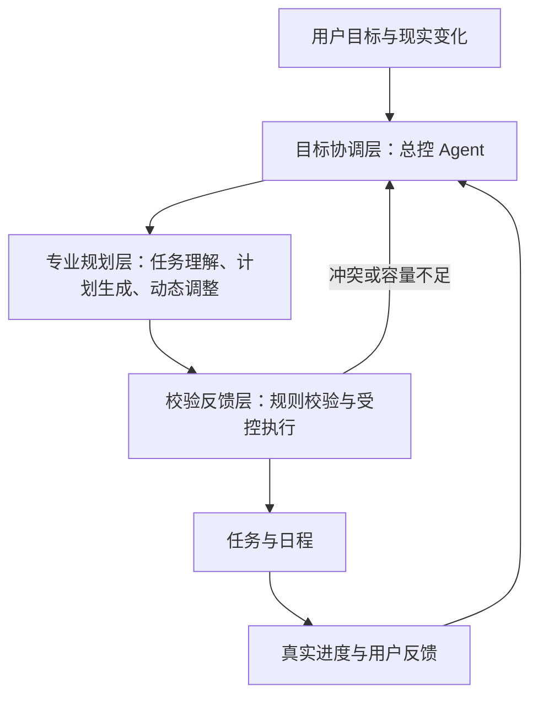

# Repland：基于多层 Agent 协同的个人动态规划系统

## 一、项目概述

Repland 是面向大学生及有个人时间管理需求人群的 Android 应用。项目以“降低规划负担，让计划随现实变化”为目标，将任务、课程、可用时间和实际执行情况结合起来，帮助用户形成可执行的计划，并在任务新增、进度变化或时间冲突时调整后续安排。

项目的核心设计是多层 Agent 协同：由总控 Agent 理解目标、分配工作，专业 Agent 生成和调整计划，校验与反馈 Agent 检查结果、连接执行反馈，形成持续更新的规划闭环。

## 二、项目背景

大学生需要同时处理课程、作业、考试、课外学习和生活事务。任务之间存在优先级和截止时间差异，可支配时间也受到课程与固定安排限制。用户即使记录了待办事项，仍需自行判断先做什么、安排多久，以及怎样在有限时间内完成。

计划还会因临时任务、实际耗时超出预期、提前完成或个人安排变化而失效。重新估算工作量、检查冲突并修改后续日程，会增加持续使用规划工具的成本。因此，Repland 关注两个相连的问题：如何帮助用户形成合理计划，以及如何在变化发生后维护计划。

## 三、项目意义

- **降低规划门槛**：用户通过自然语言表达事项和变化，由系统协助整理任务、估计工作量与分配时间，减少反复填写和手动调整。
- **提高计划的可执行性**：将任务目标与真实时间约束结合，明确哪些工作可以安排、哪些存在容量不足，帮助用户看清下一步行动。
- **支持持续调整**：依据真实进度维护剩余工作，让计划能够适应现实，而不是在第一次被打乱后失去作用。
- **探索 Agent 协同的应用方式**：研究目标理解、专业规划、结果校验与执行反馈之间的协作机制，为个人规划场景提供可解释、可控制的智能辅助方案。

## 四、项目技术方案

### 1. Android 本地优先架构

应用以 Kotlin 和 Jetpack Compose 构建交互界面，采用 ViewModel 与协程管理状态和异步任务，通过 Room 保存任务、时间约束、计划版本与执行记录。大模型通过可配置的服务接口接入，本地规划算法负责时间容量、冲突检测和基础排程。

任务、计划和实际执行分别建模：同一任务可以分成多个安排时段，计划时长不作为实际投入，计时结束也不自动等于任务完成。

### 2. 多层 Agent 协同架构

拟将 AI 助手设计为三个协作层级。每个 Agent 具有独立职责、任务上下文和调用接口，按权限使用工具，由总控按需调度。各 Agent 基于同一版本的任务与计划快照协作，最终变更由受控执行工具统一提交。

| 层级 | Agent 分工 | 主要职责 |
| --- | --- | --- |
| 目标协调层 | 总控 Agent | 理解用户目标，确定本次处理范围，选择专业 Agent，并协调冲突与重要取舍。 |
| 专业规划层 | 任务理解 Agent、计划生成 Agent、动态调整 Agent | 提取事项与约束，拆分工作、估计时长、形成候选安排；变化发生后分析影响并修复剩余计划。 |
| 校验反馈层 | 校验与反馈 Agent | 调用本地规则检查冲突、容量与保护条件，通过受控工具提交有效变更，并将执行反馈返回协调层。 |

大模型承担语义理解和方案推理，硬约束由本地确定性规则校验。校验不通过的方案返回上层修订；涉及固定承诺、真实截止或目标取舍时交由用户决定。普通变更在授权范围内执行，并保留变更说明与撤销能力。

### 3. 从初始计划到动态维护

初次规划时，总控 Agent 组织任务理解与计划生成，结合用户目标、截止时间、课程、休息和可用时间形成候选计划，经校验后写入日程。

后续以事件触发调整：新增事项、用户明确报告进度、修改可用时间等事件先交给总控判断影响，再由动态调整 Agent 处理相关任务与时段。调整优先保持原计划稳定，保留正在执行和受保护的安排，并说明未能排入的工作。

例如，用户原计划今晚 19:00—21:00 复习，随后表示“今晚 19:00—20:00 临时要开会”。系统识别新的固定占用，定位受影响的复习安排，在其他可用时间中重新分配剩余工作；容量不足时说明缺口，请用户决定取舍。

### 4. 执行反馈与持续适配

系统记录用户明确提供的进度、实际执行时长和手动调整，将其作为下一次规划的依据。在证据充分时，为估时和任务分段提供参考；证据不足时保留未知。通过计划版本、来源记录和操作撤销，让每次调整可查看、可纠正。

## 五、项目创新点

### 1. 面向规划任务的分层 Agent 协同

将目标协调、专业规划和校验反馈分层组织，使不同 Agent 围绕明确子任务协作。总控负责整体目标与调度，专业 Agent 负责形成方案，校验层负责检查与落地，支持在发现问题后返回上层修订。

### 2. 面向现实变化的动态计划修复

把“变化发生后如何调整”作为核心能力。通过事件触发、影响范围分析和局部重排，维护尚未完成的工作，减少无关任务的反复移动，在截止风险、时间容量与计划稳定性之间进行协调。

### 3. 计划生成与执行反馈形成闭环

将用户目标、候选计划、实际执行和后续调整连接起来。多层 Agent 根据新增事实更新剩余工作，使规划成为持续迭代的过程，并为逐步改进估时与安排提供依据。

### 4. 智能推理与可靠执行结合

将 Agent 的推理能力与本地约束校验、版本检查和事务提交结合，使智能方案能够可靠落地。用户可以了解调整原因、保留重要安排，并在适用条件下撤销操作。

## 六、项目目标与实现基础

项目希望实现“表达目标—形成计划—执行反馈—动态调整”的低负担使用流程，重点评估计划可行性、变化后的修复效果、原有安排的稳定性，以及用户需要介入的次数。

当前工程已具备 Android 任务管理、时间约束、本地排程、执行记录、自动调整和撤销等基础。本文提出的完整多层 Agent 协同是后续重点建设方向，其实际效果需通过实现与测试验证。
